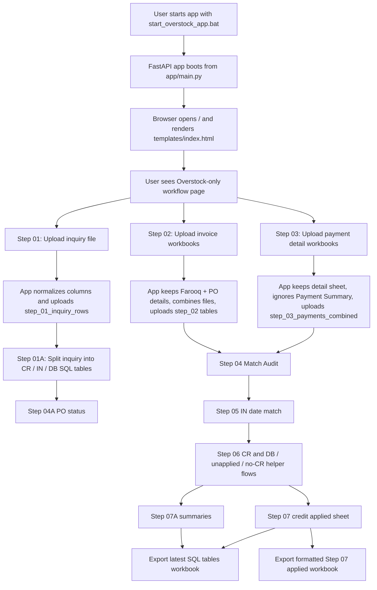
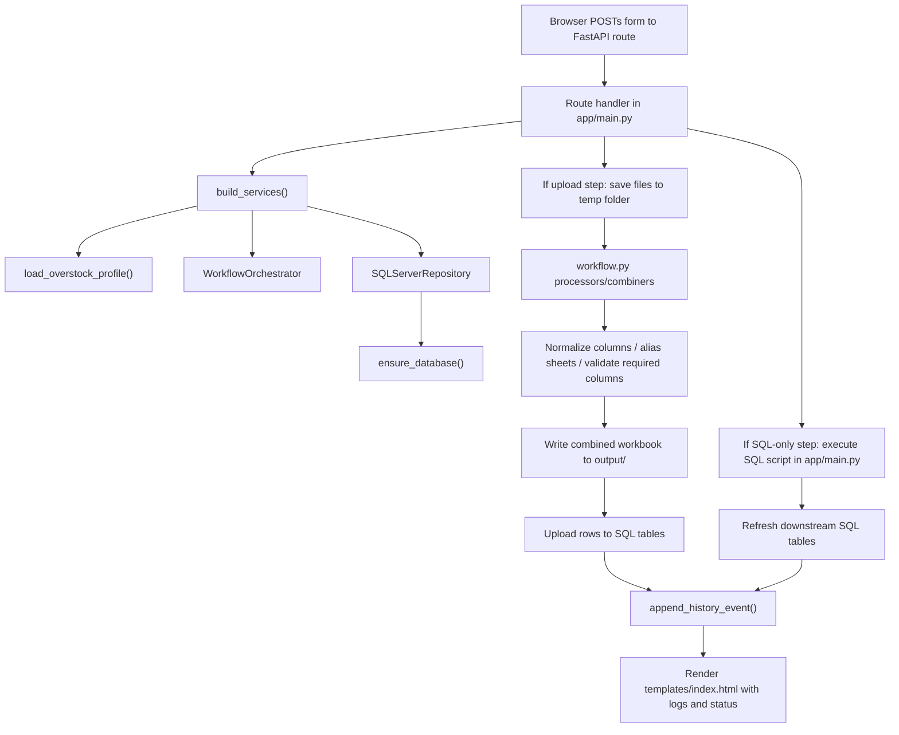

# Overstock Software Flow Diagram

This document explains the live runtime flow of the Overstock-only app in this workspace.

It separates:

1. User Flow
2. Developer / Code Flow
3. Folder Purpose
4. Query / SQL Purpose

---

## 1. User Flow

### User flow, step by step

#### Start
- User runs [start_overstock_app.bat](/abs/path/start_overstock_app.bat).
- The FastAPI server starts from [app/main.py](/abs/path/app/main.py).
- Runtime config is loaded from [app_runtime.env](/abs/path/app_runtime.env) through [app/runtime_config.py](/abs/path/app/runtime_config.py).

#### Home page
- Route: `/`
- Code: [app/main.py](/abs/path/app/main.py:4201)
- Template: [templates/index.html](/abs/path/templates/index.html)
- Purpose:
  Load the single-company Overstock workflow screen.
- What user sees:
  Step buttons, file upload inputs, download buttons, SQL health links, duplicate-resolution forms, and logs.

#### Step 01: Inquiry upload
- Route: `/process/step-01`
- Code: [app/main.py](/abs/path/app/main.py:4300)
- User action:
  Upload one inquiry file: `.xlsx`, `.xls`, or `.csv`
- What app does:
  Reads file, normalizes column names, adds missing helper columns, saves a Step 01 workbook in `output/`, uploads rows into SQL.
- Main SQL table:
  `step_01_inquiry_rows`
- Output file:
  `output/STEP_01_NORMALIZED_INQUIRY.xlsx`

#### Step 01A: CR / IN / DB split
- Route: `/process/step-01a`
- Code: [app/main.py](/abs/path/app/main.py:4345)
- User action:
  Click button after Step 01.
- What app does:
  Runs SQL that reads `step_01_inquiry_rows` and separates rows into:
  `step_01a_cr_sheet`, `step_01a_in_sheet`, `step_01a_db_sheet`
- Why:
  The inquiry data contains multiple business types in one source. This step splits them for later matching.

#### Step 02: Invoice workbooks
- Route: `/process/step-02`
- Code: [app/main.py](/abs/path/app/main.py:5284)
- User action:
  Upload one or more invoice workbooks.
- What app does:
  Keeps `Farooq` and `PO details`, removes junk/unused structure, combines same sheets across files, writes one combined workbook, uploads SQL tables.
- Main SQL tables:
  `step_02_farooq`, `step_02_po_details`
- Output file:
  `output/STEP_02_COMBINED_INVOICE.xlsx`

#### Step 03: Payment detail workbooks
- Route: `/process/step-03`
- Code: [app/main.py](/abs/path/app/main.py:5222)
- User action:
  Upload one or more payment detail workbooks.
- What app does:
  Reads `detail`, logs `Payment Summary`, ignores `Payment Summary`, combines detail rows, renames output sheet, uploads SQL table.
- Main SQL table:
  `step_03_payments_combined`
- Output file:
  `output/STEP_03_DETAIL_COMBINED.xlsx`

#### Step 04A: PO status
- Route: `/process/step-04a-po-status`
- Code: [app/main.py](/abs/path/app/main.py:4589)
- Purpose:
  Refresh PO status information before or around the match audit.

#### Step 04: Match audit
- Route: `/process/step-04a`
- Code: [app/main.py](/abs/path/app/main.py:4646)
- Purpose:
  Compare Step 02 PO rows against Step 03 payment rows.
- Main result tables:
  `step_04a_FullMatched`
  `step_04b_order_not_matched`
  `step_04c_qty_not_matched`
  `step_04d_cost_not_matched`
  `step_04e_total_not_matched`

#### Step 05: IN date match
- Route: `/process/step-05`
- Code: [app/main.py](/abs/path/app/main.py:4745)
- Purpose:
  Rebuild `Ndatee` and `Odatee`, then update `invoice_number` in `step_02_po_details`.
- Why:
  This step prepares invoice-date alignment for later CR matching logic.

#### Step 06: CR / DB / unapplied / helper sheets
- Main routes:
  `/process/step-06`
  `/process/step-06b-db`
  `/process/step-06d-unapplied`
  `/process/step-08-database-optimization`
  `/process/deductions-summary`
  `/process/step-06d02-applying-cr-update`
- Code:
  [app/main.py](/abs/path/app/main.py:4794)
  [app/main.py](/abs/path/app/main.py:4829)
  [app/main.py](/abs/path/app/main.py:4864)
  [app/main.py](/abs/path/app/main.py:4907)
  [app/main.py](/abs/path/app/main.py:4950)
  [app/main.py](/abs/path/app/main.py:4993)
- Purpose:
  This is the credit-note logic area.
- It does:
  Assign CR numbers, assign DB numbers, update unapplied CR logic, run `step_08_DataBaseOptimization` to build `NO_CR_Number`, and build `Deductions_Summary`.

#### Step 07A: Summary sections
- Routes:
  `/process/step-07a-deduction-breakdown`
  `/process/step-07a-credit-summary`
  `/process/step-07a-po-status-summary`
  `/process/step-07a-summary`
- Code:
  [app/main.py](/abs/path/app/main.py:5083)
  [app/main.py](/abs/path/app/main.py:5097)
  [app/main.py](/abs/path/app/main.py:5111)
  [app/main.py](/abs/path/app/main.py:5125)
- Purpose:
  Build summary tables used for reporting and final finance review.

#### Step 07: Credit applied sheet
- Route: `/process/step-07`
- Code: [app/main.py](/abs/path/app/main.py:5177)
- Purpose:
  Build the final credit-applied table.
- Main result table:
  `step_07_Credit_Applied_Sheet`

#### Export latest SQL tables
- Route: `/process/export-latest-tables`
- Code: [app/main.py](/abs/path/app/main.py:4413)
- Purpose:
  Put many current SQL tables into one workbook for download.

#### Export Step 07 applied workbook
- Route: `/process/export-step-07-applied`
- Code: [app/main.py](/abs/path/app/main.py:4488)
- Purpose:
  Build a formatted workbook version of the Step 07 applied result.

---

## 2. Developer Flow

### Deep developer flow

#### 2.1 App boot
- File: [app/main.py](/abs/path/app/main.py)
- The FastAPI app object is created near the top of the file.
- `settings = get_settings()` comes from [app/DbConfigLogger.py](/abs/path/app/DbConfigLogger.py), while template directory wiring uses `settings.templates_dir`.
- `DEFAULT_COMPANY_CODE = "overstock"` hard-locks the runtime to a single company.
- On startup, `startup_history_log()` records an automatic history snapshot.

#### 2.2 Runtime config loading
- File: [app/runtime_config.py](/abs/path/app/runtime_config.py)
- `load_runtime_config()` reads `app_runtime.env`.
- Important values:
  `SQL_SERVER`, `SQL_DATABASE`, `OUTPUT_DIR`, `TEMPLATES_DIR`, `HOST`, `PORT`
- Meaning:
  This file controls environment-level behavior, not business mapping logic.

#### 2.3 Company profile loading
- File: [app/adapters/company_loader.py](/abs/path/app/adapters/company_loader.py)
- Function:
  `load_overstock_profile()`
- Reads:
  [companies/overstock/company.json](/abs/path/companies/overstock/company.json)
  [companies/overstock/step_01.json](/abs/path/companies/overstock/step_01.json)
  [companies/overstock/step_02.json](/abs/path/companies/overstock/step_02.json)
  [companies/overstock/step_03.json](/abs/path/companies/overstock/step_03.json)
- Meaning:
  The app code is generic enough to read step config from JSON, but this runtime only loads Overstock.

#### 2.4 Service construction
- File: [app/main.py](/abs/path/app/main.py:3466)
- Function:
  `build_services()`
- Creates:
  `Logger`
  `WorkflowOrchestrator`
  `SQLServerRepository`
- Meaning:
  Every request builds a fresh logger and service bundle, so each button run gets its own log list.

#### 2.5 Upload-step processing

##### Step 01 processor
- File: [app/workflow.py](/abs/path/app/workflow.py)
- Class:
  `InquiryProcessor`
- Main behavior:
  `_read_file()`
  `_normalize_dataframe_columns()`
  `rename_with_aliases()`
  `ensure_required_columns()`
  `_prepare_step_01_inquiry_columns()`
- Important generated helper columns:
  `Ndatee`
  `pay_day`
  `Cclaim`
- Meaning:
  The raw inquiry file is made SQL-safe and business-ready before upload.

##### Step 02 combiner
- File: [app/workflow.py](/abs/path/app/workflow.py)
- Class:
  `InvoiceWorkbookCombiner`
- Main behavior:
  Finds sheet aliases, reads `Farooq` and `PO details`, skips first two `Farooq` rows, adds `source_file`, combines all uploads.
- Important helper columns that may be added:
  `quantiy`
  `qxc`
  `Odatee`
  `invoice_number`
  `cr_issue`
  `db_number`
  `inv_db`
  `Po_Count`
  `Total_Invoice`
  `Total_Payment`
  `diff`
  `po_status`
- Meaning:
  Step 02 makes invoice rows structurally compatible with later SQL joins and audits.

##### Step 03 combiner
- File: [app/workflow.py](/abs/path/app/workflow.py)
- Class:
  `DetailWorkbookCombiner`
- Main behavior:
  Finds `detail`, optionally logs `Payment Summary`, ignores it, combines detail sheets, adds `source_file`, creates `Sum_Total`.
- Important helper columns that may be added:
  `Sum_Total`
  `invoice_number`
  `cr_issue`
  `db_number`
  `inv_db`
  `Total_Payment`
- Meaning:
  Step 03 prepares payment-side facts for matching against invoice-side facts.

#### 2.6 Orchestrator layer
- File: [app/workflow.py](/abs/path/app/workflow.py)
- Class:
  `WorkflowOrchestrator`
- Methods:
  `run_step_01()`
  `run_step_02()`
  `run_step_03()`
- Meaning:
  This layer coordinates file processing, workbook export, and success/failure packaging for `main.py`.

#### 2.7 SQL repository layer
- File: [app/DbConfigLogger.py](/abs/path/app/DbConfigLogger.py)
- Class:
  `SQLServerRepository`
- Important responsibilities:
  `ensure_database()`
  `store_inquiry_rows()`
  `store_step_02_sheet()`
  `replace_dynamic_table_rows()`
  `execute_sql_script()`
  `execute_sql_script_with_messages()`
  `read_table()`
  `list_user_tables()`
  `delete_rows_by_column_value()`
  `purge_step01_history_by_filename()`
- Meaning:
  This is the DB gateway. It creates tables if missing, uploads rows, runs SQL, and reads results.

#### 2.8 Duplicate file workflow
- File: [app/main.py](/abs/path/app/main.py:3852)
- Main helpers:
  `_stage_duplicate_uploads()`
  `_load_duplicate_manifest()`
  `_save_duplicate_manifest()`
  `_resume_staged_step_flow()`
- Folder used:
  [duplicate_staging](/abs/path/duplicate_staging)
- Meaning:
  If a file name already exists in SQL history, the app stages uploads on disk and asks the user to `Skip` or `Force reprocess`.

#### 2.9 History logging
- File: [app/edit_history.py](/abs/path/app/edit_history.py)
- Main function:
  `append_history_event()`
- Folder used:
  [edit log](/abs/path/edit log)
- Meaning:
  Every important step writes an append-only human-readable history event.

#### 2.10 Rendering back to user
- File: [app/main.py](/abs/path/app/main.py:3792)
- Function:
  `_render()`
- It passes into the template:
  message
  logs
  SQL server/database info
  runtime paths
  download availability flags
  duplicate-resolution payload
- Meaning:
  The UI is mostly a server-rendered status/control panel, not a separate frontend app.

---

## 3. Folder Purpose

### Runtime folders

#### [app](/abs/path/app)
- Main backend code.
- Contains FastAPI routes, SQL text, workflow logic, logging, repository layer, adapters.

#### [app/adapters](/abs/path/app/adapters)
- Input adaptation helpers.
- Purpose:
  map column aliases, validate required columns, load company profile JSON.

#### [templates](/abs/path/templates)
- Jinja HTML templates.
- Runtime UI comes from [templates/index.html](/abs/path/templates/index.html).

#### [companies/overstock](/abs/path/companies/overstock)
- Overstock-only business config.
- Stores company metadata and step-specific alias / required-column JSON.

#### [output](/abs/path/output)
- Generated user-facing files.
- Example:
  normalized workbook, combined invoice workbook, combined detail workbook, latest SQL export workbook, Step 07 applied workbook, HTML docs.

#### [duplicate_staging](/abs/path/duplicate_staging)
- Temporary holding area for duplicate uploads waiting on user choice.
- Each token folder contains staged files plus `manifest.json`.

#### [edit log](/abs/path/edit log)
- Long-form AI/edit history storage.
- Human trace of important changes and runtime events.

### Config / launcher files

#### [app_runtime.env](/abs/path/app_runtime.env)
- Environment-style runtime settings for server, DB, host, port, and directories.

#### [start_overstock_app.bat](/abs/path/start_overstock_app.bat)
- Starts the app in Overstock runtime mode.

#### [stop_overstock_app.bat](/abs/path/stop_overstock_app.bat)
- Stops the app.

#### [requirements.txt](/abs/path/requirements.txt)
- Python dependency list.

### Non-runtime / support folders

#### [extras](/abs/path/extras)
- Non-runtime support files, experiments, helper scripts, old variants, extracted SQL, archived references.
- Based on `AGENTS.md`, this should stay out of the active runtime unless intentionally reused.

#### [SOFTWARE   PROCESS  FLOW  DIAGRAM](/abs/path/SOFTWARE   PROCESS  FLOW  DIAGRAM)
- Documentation/artifact folder for diagrams and flow docs.

---

## 4. Query / SQL Purpose By Stage

### Step 01 SQL meaning
- Input:
  normalized inquiry rows
- Stored into:
  `step_01_inquiry_rows`
- Purpose:
  preserve inquiry facts in SQL-safe format for later business splitting.

### Step 01A SQL meaning
- Query source:
  `step_01_inquiry_rows`
- Query logic:
  split by `ref` pattern into CR / IN / DB groups
- Output tables:
  `step_01a_cr_sheet`
  `step_01a_in_sheet`
  `step_01a_db_sheet`

### Step 02 SQL meaning
- Input:
  combined workbook sheets
- Output tables:
  `step_02_farooq`
  `step_02_po_details`
- Purpose:
  store invoice-side operational rows.

### Step 03 SQL meaning
- Input:
  combined payment `detail` sheet
- Output table:
  `step_03_payments_combined`
- Purpose:
  store payment-side rows.

### Step 04 SQL meaning
- Query joins:
  `step_02_po_details` with `step_03_payments_combined`
- Purpose:
  classify relationship quality between invoice rows and payment rows.
- Output:
  matched and mismatch tables.

### Step 05 SQL meaning
- Purpose:
  clean and derive date/linking fields used for later invoice-number and CR matching.

### Step 06 SQL meaning
- Purpose:
  assign credits, debit numbers, unapplied credit logic, and missing-credit support sheets.
- This is where much of the finance reconciliation intelligence lives.

### Step 07A SQL meaning
- Purpose:
  summarize deductions, gross/deduction/net values, and PO status.

### Step 07 SQL meaning
- Purpose:
  produce the final credit-applied output table used for export/reporting.

---

## 5. Real End-to-End Meaning

The whole app is a controlled reconciliation pipeline:

1. User uploads inquiry, invoice, and payment files.
2. Python normalizes messy spreadsheet structure into stable SQL-safe tables.
3. SQL performs classification, matching, date derivation, CR/DB assignment, and summary building.
4. The app exports workbooks so the user can review or deliver the results.

In short:

- `workflow.py` prepares spreadsheet data.
- `DbConfigLogger.py` moves data in/out of SQL Server.
- `main.py` is the command center.
- `templates/index.html` is the workflow control panel.
- `companies/overstock/*.json` defines what the app expects from Overstock files.

