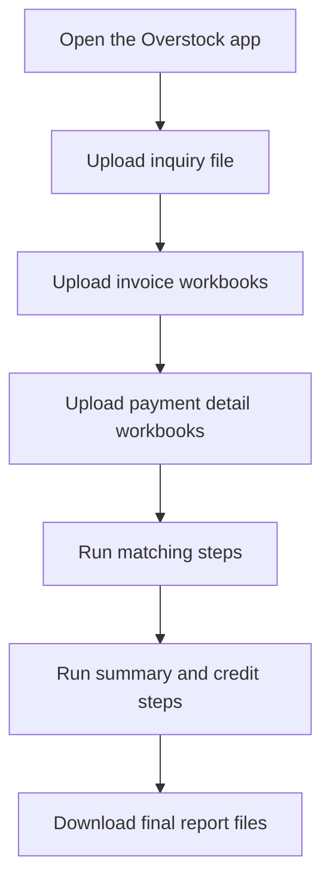

# Overstock Staff User Flow

## Purpose

This is the simple version for staff and non-technical users.

The app helps turn Overstock inquiry, invoice, and payment files into matched reports.

---

## Simple Workflow

## What each step means

- `Step 01`
  Loads the inquiry file and prepares it for the system.
- `Step 02`
  Combines invoice workbooks into one clean invoice dataset.
- `Step 03`
  Combines payment detail workbooks into one clean payment dataset.
- `Step 06`
  Handles credit note, debit number, unapplied credit, and deduction logic.
- `Step 07A`
  Builds summary reports.
- `Step 07`
  Builds the final credit applied result.

---

## Main folders staff should know

- `output/`
  Final generated files are saved here.
- `duplicate_staging/`
  Temporary holding area when the app finds the same file name again.
- `templates/`
  The app screen layout lives here.
- `companies/overstock/`
  Overstock-specific setup rules live here.

---

## Short explanation

The app takes multiple spreadsheet files, cleans them, checks how they match, applies credit/debit logic, and gives the user finished report files to download.

